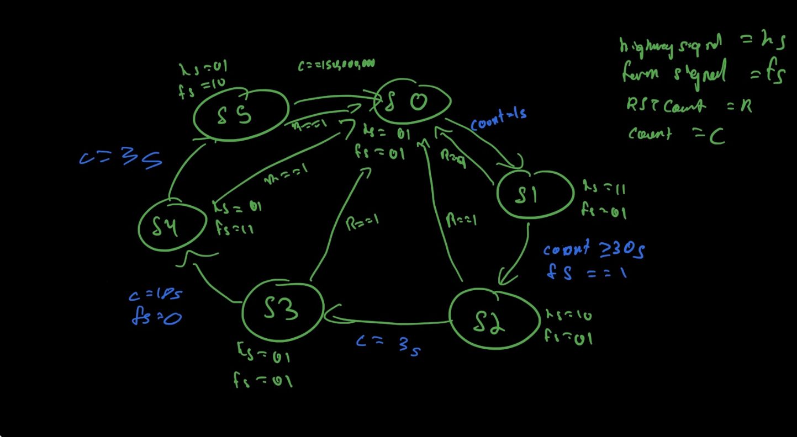
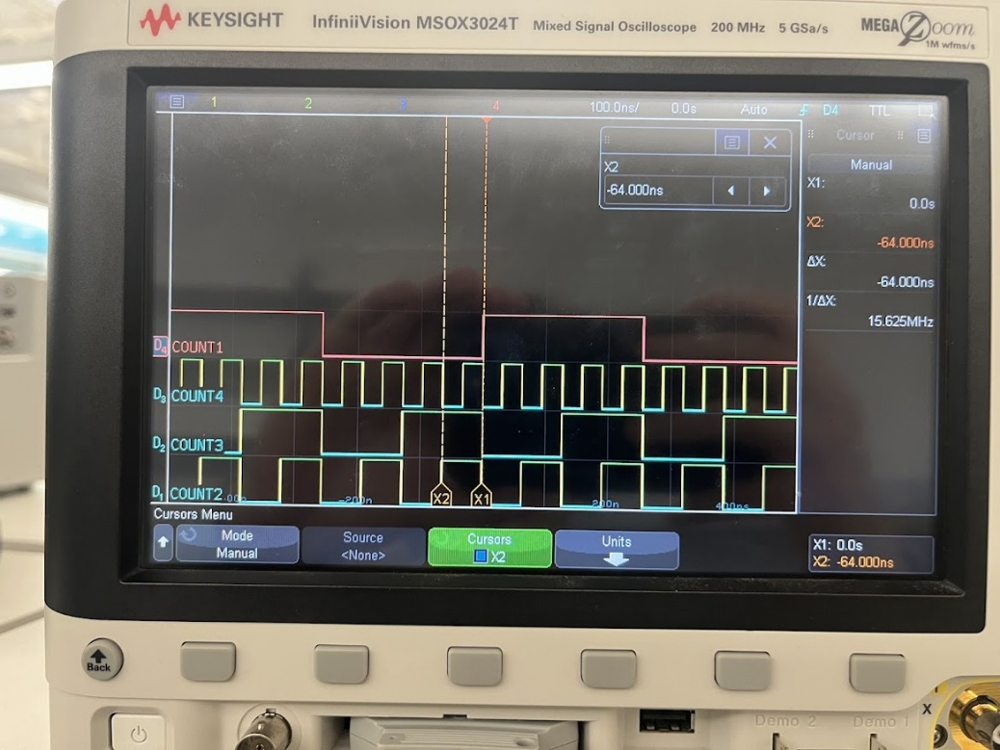
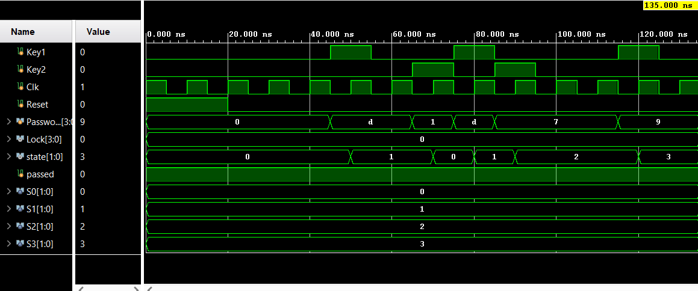

# Finite state machines in Verilog on an FPGA

Two state machines I wrote in Verilog for ECEN 248 (Digital Systems Design, Texas A&M, fall 2025). Both were simulated in Vivado, then synthesized and run on a Digilent Zybo board, with the outputs on the board's LEDs and checked on a Keysight oscilloscope.

## Traffic light controller

The controller runs the lights at an intersection between a highway and a farm road. It has three modules. `counter.v` is a free-running counter on the board's 50 MHz clock. `tlc_fsm.v` is a six-state machine that holds each light combination for a fixed number of clock cycles, using the light encoding 01 = red, 11 = green, 10 = yellow. `tlc_top.v` wires the two together and puts the current state on a Pmod header so I could probe it.



| State | Highway | Farm road | Cycles | Time |
|---|---|---|---|---|
| S0 | red | red | 50,000,000 | 1 s |
| S1 | green | red | 1,500,000,000 | 30 s |
| S2 | yellow | red | 150,000,000 | 3 s |
| S3 | red | red | 50,000,000 | 1 s |
| S4 | red | green | 750,000,000 | 15 s |
| S5 | red | yellow | 150,000,000 | 3 s |

The counter width came out of the longest state. 30 s at 50 MHz is 1.5 billion cycles, and since 2^30 is about 1.07 billion and 2^31 is about 2.15 billion, the counter needs 31 bits. The two all-red states give the intersection a one-second clearance before either road gets a green.

Before this lab I built and tested the counter and clock-divider logic on its own. This is the counter's output bits on the scope, each one toggling at half the rate of the one before it:



## Combination lock

A Moore machine that only unlocks after three correct 4-bit codes are entered in order (13, then 7, then 9), each confirmed with a button press. A wrong code at any step sends it back to the start. The output depends only on the current state, so all four lock LEDs light up once it reaches the unlocked state, and they stay on until reset.



## Running it

All of the Verilog compiles with Icarus Verilog, so you don't need Vivado to check it:

```
iverilog -g2012 -o tlc traffic_light_controller/*.v
iverilog -g2012 -o lock combination_lock/combination_lock_fsm.v
```
